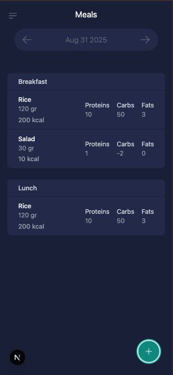
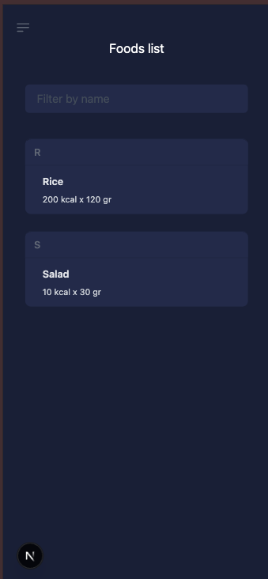
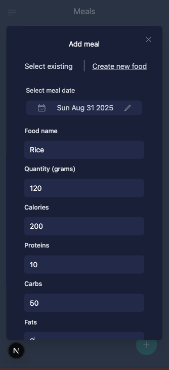

# Calories Tracker (Rust + React/TypeScript)

A mobile-first web app to track **daily calories and macros**. Log meals and foods, see your day’s totals, and keep your nutrition on track.

<div align="center">
  <!-- Replace file names if yours differ -->
  
  
  
</div>

---

## Features

- 🍽️ Log meals/foods with calories and macros (C/F/P)
- 📅 Day view with running totals
- 🔎 Simple, fast UI optimized for mobile
- 💾 Persistent storage in MongoDB
- 🦀 Rust backend for speed and reliability (mostly curiosity 😉 )

---

## Tech Stack

**Frontend**
- React + TypeScript (mobile-first UI)

**Backend**
- Rust
- MongoDB for persistence


## How to run

### Run the backend

You need to first set up a `.env` file in the `server` folder and specify the 
`MONGO_URI` and `APP_NAME` environment variable.
Then you may run:

```bash
cd server
cargo run
```

### Run the frontend
```bash
cd client
npm run dev
```


### Run with Docker Compose (WIP)

```bash
docker compose up -d
```

Application should now be visible at [http://localhost:3000/](http://localhost:3000/)

You may now open the app at [http://localhost:3000](http://localhost:3000)


## App preview


